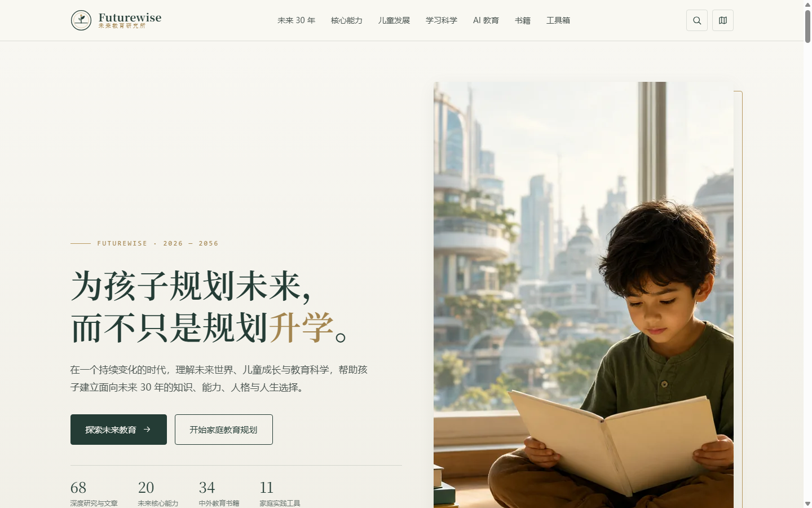
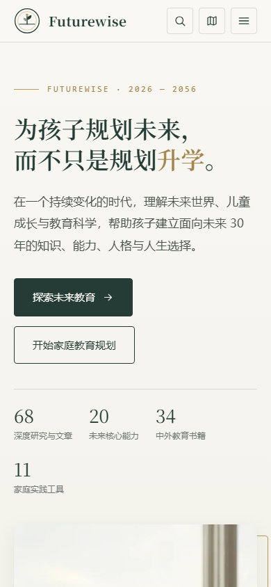
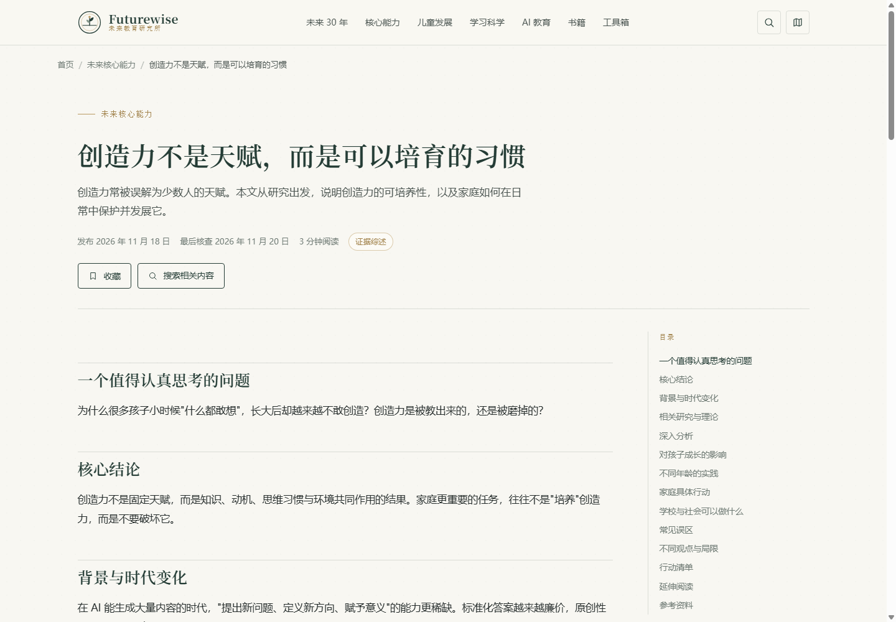

# Futurewise · 未来教育研究所

> **为孩子规划未来，而不只是规划升学。**
> Plan for the Future, Not Just the Next Exam.

Futurewise 是一个面向未来 30 年（2026 — 2056）的家庭教育规划、儿童成长与教育研究知识平台。它不追逐短期教育风口，而是帮助家庭理解正在变化的世界、理解孩子成长的规律、研究哪些能力值得长期培养，并在不确定性中作出更理性、更有远见的选择。

## 编辑理念

我们不试图预测三十年后每一个孩子应该从事什么职业，也不试图给出一套适用于所有家庭的教育答案。

我们希望理解正在变化的世界，理解孩子成长的规律，研究哪些能力值得长期培养，并帮助每个家庭在不确定性中作出更理性、更有远见的选择。

**教育不是替孩子安排好未来，而是帮助孩子逐渐拥有选择未来的能力。**

这也是 Futurewise 这个名字的含义：面向未来的智慧，而不是追逐某一种短期教育风口。

## 实际运行截图

以下截图均来自本项目真实运行实例（`npm run dev` 后通过无头浏览器按真实视口截取），非设计稿或外部素材。

| 桌面首页 | 移动首页 | 文章详情 |
| --- | --- | --- |
|  |  |  |

## 三大特色功能

1. **未来 30 年教育时间轴**（`/future-2056`）
   以 2026、2030、2035、2040、2045、2050、2056 为观察节点，区分"已发生的事实 / 当前趋势 / 合理推断 / 未来情景"，研究技术与社会变化对教育的影响，并给出每个节点家庭可做的事与不确定性提示。
2. **家庭教育战略地图**（`/tools/strategy-map`）
   把成长规划拆成 **基础知识、核心能力、兴趣探索、身体健康、人格发展** 五个维度，每个维度提供年度、季度、每周行动与观察指标，配战略地图插画与雷达图。
3. **教育知识与书籍关联图谱**（`/knowledge-map`）
   从"创造力"等任一节点进入，可走到相关儿童发展研究、学习科学文章、推荐书籍、家庭实践与全球教育机构，点击节点重新展开网络，逐步形成真正的知识网络。

## 内容规模（v1）

| 类别 | 数量 | 说明 |
| --- | --- | --- |
| 深度文章 | 53 | 14 段式结构：问题 / 结论 / 背景 / 研究 / 分析 / 影响 / 分龄实践 / 家庭行动 / 学校社会 / 误区 / 不同观点与局限 / 行动清单 / 延伸阅读 / 参考资料 |
| 未来趋势研究 | 15 | 区分事实、趋势、推断与情景 |
| 未来核心能力 | 20 | 定义 / 重要性 / 基础 / 分龄实践 / 家庭 / 学校 / 误区 / 评估 |
| 儿童发展专题 | 15 | 科学解释 / 证据边界 / 信号 / 注意事项 |
| 年龄阶段指南 | 7 | 0-3 / 3-6 / 6-9 / 9-12 / 12-15 / 15-18 / 18+ |
| 教育书籍 | 34 | 核实作者与版本，标注争议与局限 |
| 全球教育资源 | 30 | 国际机构 + 中国机构，官方网址核实 |
| 家庭实践工具 | 11 | 无需注册，localStorage 本地保存，可导出 / 导入 |
| 原创 SVG 插画 / 图表 | 15+ / 8 | 全部原创，无外部图片依赖 |

## 十大栏目

未来 30 年（Future 2056）· 未来核心能力（Future Skills）· 儿童发展（Child Development）· 家庭教育（Family Education）· 学习科学（Learning Science）· AI 与教育（AI & Education）· 未来学校（Future School）· 职业与人生（Career & Life）· 书籍与资源（Books & Resources）· 家庭工具箱（Family Toolkit）

另有：年龄指南、全站搜索、知识图谱、关于 / 编辑原则 / 参考资料 / 隐私 / 联系。

## 技术栈

刻意保持轻量，无大型 UI 库、无 SSR、无数据库、无复杂后端：

- **Vite + React + TypeScript**：构建与类型安全
- **React Router（HashRouter）**：适配 GitHub Pages 子路径，避免刷新 404
- **原生 CSS**：品牌设计系统（纸色 / 森林绿 / 墨色 / 鼠尾草 / 金 / 蓝），系统字体
- **Markdown 内容**：`import.meta.glob` 加载 + 自研 frontmatter 解析 + marked 渲染 + 目录注入
- **localStorage**：工具数据、收藏、最近阅读，全部本地，可 JSON 导出 / 导入
- **本地搜索索引**：全站内容检索，无需后端
- **原创 SVG**：插画与图表内联，无远程图片依赖

## 目录结构

```
futurewise-education/
├─ .github/workflows/deploy.yml   # GitHub Pages 官方 Actions 部署
├─ docs/screenshots/              # 真实运行截图
├─ public/
│  ├─ images/                     # 优化后的 WebP 图片（AI 生成原创）
│  ├─ favicon.svg / robots.txt / sitemap.xml / rss.xml
├─ scripts/
│  ├─ generate-sitemap.mjs        # 生成 sitemap.xml 与 rss.xml
│  └─ screenshot.mjs              # 无头浏览器真实截图（CDP）
├─ src/
│  ├─ content/{articles,trends}/  # Markdown 深度内容
│  ├─ data/                       # 能力 / 发展 / 年龄 / 书籍 / 资源 / 工具 / 战略 / 时间轴
│  ├─ components/{ui,home,illustrations,charts,articles}/
│  ├─ pages/                      # 路由页面
│  ├─ lib/                        # content / markdown / seo / hooks / storage / graph / utils
│  ├─ styles/                     # base / layout / ui / home / interactive
│  └─ types/
├─ index.html
├─ vite.config.ts                 # base 子路径 + 手动分包
└─ tsconfig.json
```

## 快速开始

```bash
npm install        # 安装依赖
npm run dev        # 开发服务器（默认 http://localhost:5173）
npm run build      # 生成 sitemap/rss + 类型检查 + 生产构建（输出 dist/）
npm run preview    # 预览生产构建
npm run typecheck  # 仅类型检查
npm run sitemap    # 仅重新生成 sitemap.xml / rss.xml
```

真实截图（需本机 Chrome，且 dev 服务器运行中）：

```bash
node scripts/screenshot.mjs
```

## 部署到 GitHub Pages

仓库已内置官方 Actions 工作流 [.github/workflows/deploy.yml](.github/workflows/deploy.yml)：push 到 `main` 自动执行 `npm ci → npm run build → 上传 dist → 部署`。

启用步骤：

1. 将仓库推送到 GitHub。
2. 打开 **Settings → Pages**，将 **Build and deployment → Source** 设为 **GitHub Actions**。
3. 推送 `main` 分支，等待 Actions 完成，站点地址形如 `https://<user>.github.io/futurewise-education/`。

### 子路径与自定义域名

- 默认构建 `base` 为 `/futurewise-education/`（项目站点子路径）。
- 绑定自定义域名或部署到用户站点（根路径）时，设置环境变量 `VITE_BASE=/` 再构建：
  ```bash
  VITE_BASE=/ npm run build
  ```
- 使用 **HashRouter**，所有路由形如 `/#/articles/xxx`，GitHub Pages 无需额外 404 回退配置。

### 常见问题

- **刷新 404**：本项目用 HashRouter，正常不会发生；若改用 BrowserRouter 需自行配置 404 回退。
- **资源 404 / 页面空白**：检查 `base` 与实际部署路径是否一致（子路径 vs 根路径）。
- **`vite preview` 子路径下资源回退为 HTML**：这是 preview 中间件行为，GitHub Pages 为纯静态服务不受影响；本地验证子路径产物建议用静态服务器直接服务 `dist/`。

## 内容与编辑原则

- 区分**科学证据、专家观点、经验与个人判断**；不把相关性当因果，不把单一研究当共识。
- 不虚构研究、论文、统计数据、专家观点或机构报告；书籍作者 / 译名 / 出版信息核实；机构官方网址核实。
- 不夸大早期教育或某种训练的效果；不制造家长焦虑；不宣称某种路径保证成功；不把未来职业预测当事实。
- 尊重儿童个体差异、发展节奏与自主性；不对儿童做未经验证的心理 / 智力 / 人格诊断。
- 心理健康、发展障碍等专业问题，建议咨询合格专业人员。
- 每篇内容标注来源、发布日期与最后核查日期；对争议主题展示不同观点与证据局限。
- 未来预测明确区分：已发生的事实 / 当前趋势 / 合理推断 / 未来情景。

详见站内 [编辑原则](https://futurewise-education.github.io/futurewise-education/#/editorial-policy) 与 [参考资料](https://futurewise-education.github.io/futurewise-education/#/sources)。

## 图片与版权说明

- `public/images/` 下的 WebP 图片为 **AI 生成的原创图像**（非真实照片、非第三方版权素材），已优化压缩；如需替换为真实摄影，请确保授权并保留署名。
- 全部插画与图表为**原创内联 SVG**，无外部图片链接依赖。
- 书籍封面为原创设计的示意封面（色块 + 书名），非出版社封面扫描。
- 引用的书籍、机构与文献仅做介绍与评论，版权归原作者 / 机构所有。

## 隐私与数据

所有工具数据、收藏与最近阅读仅保存在用户浏览器 `localStorage`（前缀 `futurewise:`），不上传服务器；支持 JSON 导出备份与导入恢复。详见站内隐私页。

## Roadmap

- 扩充文章与趋势研究至 100+，补充更多分龄实践案例
- 知识图谱增加关系类型过滤与路径高亮
- 战略地图支持自定义维度与导出为 PDF
- 多语言（英文）版本
- 可选的静态 RSS / Newsletter 归档页

## 贡献

欢迎提交 Issue 与 PR。内容类贡献请遵循上述编辑原则：提供可核实来源、标注证据等级与局限、不制造焦虑。代码类贡献请保持轻量技术栈与品牌设计系统一致。

---

© 2026 Futurewise · 未来教育研究所 · Plan for the Future, Not Just the Next Exam.
